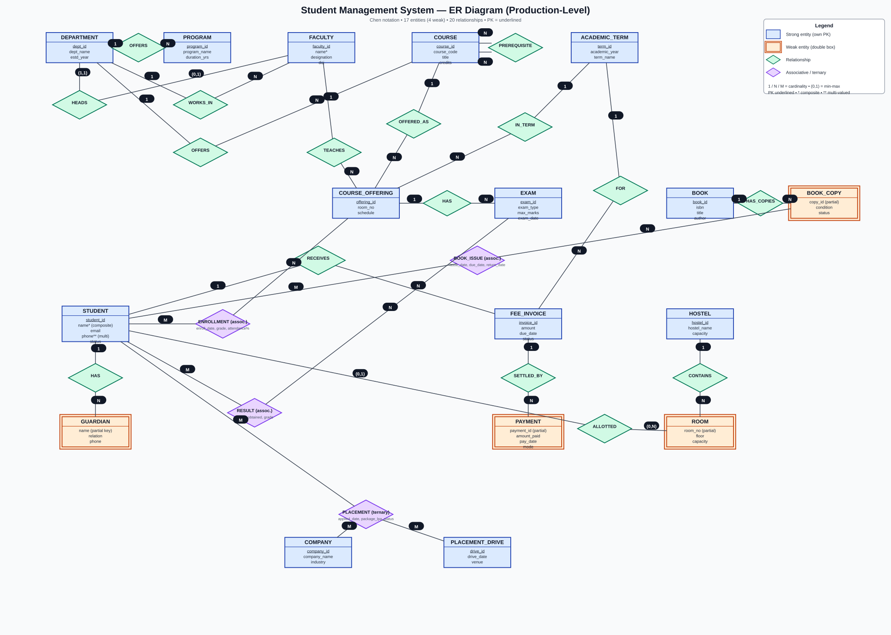

# Student Management System — ER Diagram (Production-Level)

> Ye **toy example nahi** hai — real college/ERP me jaisa data model hota hai, waisa banaya gaya hai. Sirf concept (entities, relationships, constraints) — koi implementation code nahi.

---

## 1. Overview

Ye diagram ek college ke **6 domains** cover karta hai:

| Domain | Entities |
|---|---|
| Organization | DEPARTMENT, PROGRAM, FACULTY, COURSE |
| Academics | ACADEMIC_TERM, COURSE_OFFERING, EXAM |
| People | STUDENT, GUARDIAN |
| Finance | FEE_INVOICE, PAYMENT |
| Campus | HOSTEL, ROOM |
| Library | BOOK, BOOK_COPY |
| Placements | COMPANY, PLACEMENT_DRIVE |

**Total: 17 entities** (13 strong + 4 weak), **20 relationships**.

## 2. Diagram Kaise Padhein

- **Neela box** = Strong entity (apni PK hai) | **Orange double box** = Weak entity (owner par dependent)
- **Hara diamond** = Relationship | **Purple diamond** = Associative entity / Ternary relationship
- **Underline** = Primary Key | `*` = composite attribute | `**` = multi-valued attribute
- Line par **1 / N / M** = cardinality | **(0,1), (1,1), (0,N)** = min-max notation (Module 3, 3.5)

---

## 3. Entity Catalog (har entity kyun hai?)

### Organization
- **DEPARTMENT** (strong) — `dept_id` PK. Har department ka naam aur establish year. Bina department ke college structure nahi ban sakta — isliye kai entities isi se judti hain.
- **PROGRAM** (strong) — `program_id` PK. Degree programs (B.Tech, M.Tech). Ek department multiple programs offer karta hai.
- **FACULTY** (strong) — `faculty_id` PK. `name*` composite hai (first/middle/last me toot sakta hai). Har faculty exactly ek department me kaam karta hai.
- **COURSE** (strong) — `course_id` PK, `course_code` unique (e.g. "CS301"). Subject ka master record — ye **syllabus** hai, class nahi. Actual class `COURSE_OFFERING` me hoti hai (neeche dekho).

### Academics
- **ACADEMIC_TERM** (strong) — `term_id` PK. Semester system ka time frame (2026-27 Odd). Fees, offerings, exams — sab term se judte hain.
- **COURSE_OFFERING** (strong) — `offering_id` PK. **Ye sabse important design decision hai:** "DBMS subject" (COURSE) vs "DBMS ki Monday 10 AM wali class jo Prof. Sharma padha rahe hain" (OFFERING) — alag cheezien hain. Ek course har term me multiple sections me offer ho sakta hai.
- **EXAM** (strong) — `exam_id` PK. Har offering ke multiple exams (midterm, endterm, quizzes).

### People
- **STUDENT** (strong) — `student_id` PK. `name` composite, `phone` multi-valued (ek student ke multiple numbers), `status` (active/inactive/graduated).
- **GUARDIAN** (weak, owner = STUDENT) — `name` **partial key** hai: "Ramesh" naam kai students ke guardian ka ho sakta hai, par **ek student ke andar unique** hai. Bina student ke guardian ka koi matlab nahi — isliye weak + total participation.

### Finance
- **FEE_INVOICE** (strong) — `invoice_id` PK. Har term ki fees ka bill. `status` (paid/pending/overdue) — production me records delete nahi karte, status badalte hain.
- **PAYMENT** (weak, owner = FEE_INVOICE) — `payment_id` partial key. Ek invoice ke against **multiple part-payments** ho sakte hain (pehle 20k, phir 30k) — isliye 1:N. Bina invoice ke payment ka matlab nahi.

### Campus
- **HOSTEL** (strong) — `hostel_id` PK.
- **ROOM** (weak, owner = HOSTEL) — `room_no` partial key: Room 101 har hostel me ho sakta hai, par **ek hostel ke andar unique**. Room hostel ke bina exist nahi kar sakta.

### Library
- **BOOK** (strong) — `book_id` PK, `isbn` unique. Book ka **title-level** record (e.g. "DBMS by Korth").
- **BOOK_COPY** (weak, owner = BOOK) — `copy_id` partial key. Library me DBMS ki **5 physical copies** hain — har copy ka apna condition/status. Issue **copy** hoti hai, title nahi — isliye BOOK_ISSUE, COPY se judta hai.

### Placements
- **COMPANY** (strong) — `company_id` PK.
- **PLACEMENT_DRIVE** (strong) — `drive_id` PK. Ek company multiple drives me aa sakti hai, ek drive me multiple companies — isliye drive alag entity hai.

---

## 4. Relationship Catalog (business rule + cardinality)

| # | Relationship | Entities | Cardinality | Business rule |
|---|---|---|---|---|
| 1 | OFFERS | DEPARTMENT → PROGRAM | 1:N | Ek dept multiple programs offer karta hai |
| 2 | WORKS_IN | FACULTY → DEPARTMENT | N:1 | Har faculty exactly ek dept me (min-max: faculty side (1,1)) |
| 3 | HEADS | FACULTY ↔ DEPARTMENT | 1:1 | Ek dept ka ek HOD. Faculty side **(0,1)** — har faculty HOD nahi hota (partial); Dept side **(1,1)** — har dept ka HOD hona chahiye (total) |
| 4 | OFFERS | DEPARTMENT → COURSE | 1:N | Dept multiple subjects own karta hai |
| 5 | PREREQUISITE | COURSE ↔ COURSE | M:N (unary) | "OS ke liye DBMS compulsory hai" — course ka course se relation (**recursive**) |
| 6 | OFFERED_AS | COURSE → OFFERING | 1:N | Ek subject har term me multiple sections me |
| 7 | IN_TERM | TERM → OFFERING | 1:N | Ek term me kai offerings |
| 8 | TEACHES | FACULTY → OFFERING | 1:N | Ek faculty multiple sections padha sakta hai |
| 9 | HAS | OFFERING → EXAM | 1:N | Har offering ke multiple exams |
| 10 | HAS | STUDENT → GUARDIAN | 1:N | Guardian weak hai — total participation |
| 11 | ENROLLMENT | STUDENT ↔ OFFERING | M:N (associative) | Student multiple offerings me, offering me multiple students. Attributes: enroll_date, grade, attendance% |
| 12 | RESULT | STUDENT ↔ EXAM | M:N (associative) | Har student-exam combo ka marks + grade |
| 13 | RECEIVES | STUDENT → FEE_INVOICE | 1:N | Har term ka bill |
| 14 | SETTLED_BY | INVOICE → PAYMENT | 1:N | Part-payments allowed; payment weak hai |
| 15 | FOR | TERM → FEE_INVOICE | 1:N | Bill hamesha kisi term ka hota hai |
| 16 | CONTAINS | HOSTEL → ROOM | 1:N | Room weak hai — total participation |
| 17 | ALLOTTED | STUDENT ↔ ROOM | (0,1):(0,N) | **Dono taraf partial** — har student hostel me nahi rehta, har room bhara nahi hota. Ek student ek time par ek hi room me |
| 18 | HAS_COPIES | BOOK → BOOK_COPY | 1:N | Copy weak hai — total participation |
| 19 | BOOK_ISSUE | STUDENT ↔ BOOK_COPY | M:N (associative) | Issue hamesha **copy** ki hoti hai. Attributes: issue_date, due_date, return_date |
| 20 | PLACEMENT | STUDENT + COMPANY + DRIVE | **Ternary** | Teen entities ek saath — kaunsa student, kis company me, kaunsi drive se. Attributes: applied_date, package_lpa, status |

---

## 5. Production Design Decisions (kyun aise banaya?)

1. **COURSE vs COURSE_OFFERING alag kyun?** Real system me "subject" aur "class" alag hote hain. DBMS subject ek hai, par uski 3 sections alag faculty, alag room, alag time par chalti hain. Attendance, exam, enrollment — sab **offering** se judte hain, subject se nahi.
2. **M:N relationships me associative entity kyun?** ENROLLMENT sirf link nahi hai — uspar **grade aur attendance%** store hota hai. Jab relationship ke apne attributes hon, to associative entity banao (Module 3, 3.5 — Aggregation jaisa concept).
3. **Weak entities kahan aur kyun?** GUARDIAN, PAYMENT, ROOM, BOOK_COPY — ye chaaron **apne owner ke bina exist nahi kar sakte** aur inka key **partial** hai (owner ki key ke saath milkar complete hota hai).
4. **PLACEMENT ternary kyun, 3 binary kyun nahi?** (Module 3, 3.4 ka rule) — teen binary relationships (student-company, company-drive, student-drive) **original meaning kho denge**: "Rahul ko Google se 2026 wali drive me offer mila" — ye teeno ka **ek saath** hona zaroori hai.
5. **PREREQUISITE unary kyun?** Course ka relation course se hi hai — recursive relationship, M:N (ek course ke multiple prerequisites, ek course multiple courses ka prerequisite).
6. **Surrogate keys** (`student_id`, `invoice_id`...) — real systems me auto-generated IDs use hote hain, naam/roll-number jaise natural keys par depend nahi karte (naam badal sakta hai, duplicate ho sakta hai).
7. **`status` fields** — records delete karne ke bajaye status badalte hain (active/inactive/paid/pending). Ye **audit trail** bachata hai — production ka golden rule.
8. **Derived attributes store nahi kiye** — age (DOB se), total paid amount (payments se) — calculate kar lo, store mat karo (Module 3, 3.2).

---

## 6. Module 3 Concept Map (kya kahan use hua)

| Concept (Module 3) | Diagram me kahan |
|---|---|
| Strong entity | DEPARTMENT, STUDENT, COURSE... (13) |
| Weak entity + partial key | GUARDIAN, PAYMENT, ROOM, BOOK_COPY (4) |
| Composite attribute | STUDENT.name, STUDENT.address |
| Multi-valued attribute | STUDENT.phone |
| 1:1 | HEADS (faculty-department) |
| 1:N / N:1 | OFFERS, WORKS_IN, TEACHES, HAS... |
| M:N + associative entity | ENROLLMENT, RESULT, BOOK_ISSUE |
| Unary (recursive) | PREREQUISITE (course-course) |
| Binary | Baaki sab |
| Ternary | PLACEMENT (student-company-drive) |
| Total participation (double line) | Guardian, Payment, Room, Copy — weak entities |
| Partial participation | HEADS me faculty (0,1); ALLOTTED dono taraf |
| Min-max notation | HEADS (1,1)/(0,1); ALLOTTED (0,1)/(0,N) |

## 7. Interview Questions (is diagram se)

- **Q: COURSE aur COURSE_OFFERING alag kyun hain?** → Subject (master) vs class/section (term-specific). Enrollment, exam, attendance offering-level concepts hain.
- **Q: ENROLLMENT ko entity kyun banaya, relationship kyun nahi?** → M:N hai + apne attributes (grade, attendance%) hain → associative entity.
- **Q: BOOK_ISSUE, BOOK se kyun nahi judta?** → Issue physical **copy** ki hoti hai, title ki nahi. Har copy ka alag status hota hai.
- **Q: PLACEMENT ternary kyun hai?** → Teen binary me todne se "kaunsi drive se kaunsi company me kaunsa student" wali combined meaning kho jayegi.
- **Q: GUARDIAN weak entity kyun hai?** → Apna complete key nahi (name partial key hai), aur student ke bina exist nahi kar sakta.
- **Q: ALLOTTED me dono taraf partial participation kyun?** → Har student hostel nahi leta (day scholar), har room occupied nahi hota.
