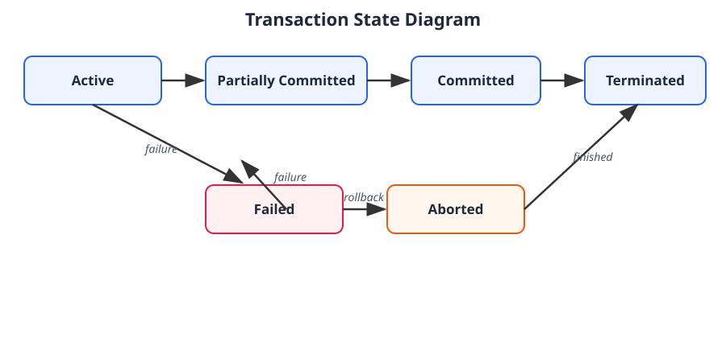

# 8.1 Transaction Fundamentals

## What is a Transaction?

A **Transaction** is a group of one or more database operations performed together as a **single logical unit of work**.

In simple words: a transaction means completing one task in the database. **Either the entire task completes successfully, or all its changes are cancelled.** There is no halfway.

### Example: Bank Money Transfer

Rahul wants to transfer ₹1,000 to Amit. Two operations are needed:

1. Deduct ₹1,000 from Rahul's account
2. Add ₹1,000 to Amit's account

| | Rahul | Amit |
|---|---|---|
| Before | ₹5,000 | ₹2,000 |
| After (one transaction, two operations) | ₹4,000 | ₹3,000 |

**What if something goes wrong?** Suppose ₹1,000 is deducted from Rahul, but the system crashes before Amit is credited. Money disappears — an inconsistent state. DBMS solves this with transactions: **either both operations succeed, or both are rolled back.** This is called **Atomicity** (one of the ACID properties).

---

## Transaction States

A transaction passes through different states during execution. There are **six** states:

### 1. Active State — Transaction is running
The first state. When a transaction starts executing its operations, it is Active.

*Example:* DBMS starts Rahul's transfer, deducts ₹1,000 from Rahul, and is processing the next operation. Right now it is **Active**.

### 2. Partially Committed State — Operations done, final commit pending
All operations executed successfully, but changes are **not yet guaranteed permanent**.

*Example:* ₹1,000 deducted from Rahul AND ₹1,000 added to Amit. DBMS is now preparing to make it permanent. The transaction is **Partially Committed**.

### 3. Committed State — Transaction successful
The commit operation succeeded. All changes are now committed to the database.

*Example:* Rahul = ₹4,000, Amit = ₹3,000, DBMS commits successfully. Changes are permanent.

### 4. Failed State — Transaction cannot continue
An error or failure stops the transaction. Reasons: system crash, power failure, database error, constraint violation, insufficient balance.

*Example:* Rahul has only ₹500 but tries to transfer ₹1,000. The transaction **fails**.

### 5. Aborted State — Changes rolled back
After failure, DBMS performs a **rollback** to undo the transaction's changes. Once undone, the transaction is Aborted.

*Example:* ₹1,000 was deducted from Rahul, then the system failed before Amit got the money. DBMS rolls back — Rahul's balance is restored to ₹5,000. The transaction is **Aborted**. It can now restart or terminate.

### 6. Terminated State — Transaction finished
The final state. After a transaction is Committed or Aborted, it becomes Terminated. DBMS no longer manages it.

*Example:* Transfer succeeds → Committed → Terminated. Transfer fails → Aborted → Terminated.

---

## Transaction State Diagram

**Flow to remember:**
- **Success path:** Active → Partially Committed → Committed → Terminated
- **Failure path:** Active → Failed → Aborted → Terminated
- **Late failure:** Partially Committed → Failed → Aborted → Terminated (failure can happen even after all operations complete, before commit succeeds)

---

## Quick Revision Table

| State | Meaning |
|---|---|
| Active | Transaction is executing |
| Partially Committed | All operations completed, final commit pending |
| Committed | Changes successfully committed |
| Failed | Transaction cannot continue |
| Aborted | Changes rolled back |
| Terminated | Transaction has finished |

## Test Your Understanding

**Q1.** In which state does a transaction start executing?
- a) Committed b) Active c) Aborted → **Answer: b) Active**

**Q2.** All operations are completed, but the commit is not yet successful. Which state?
- a) Partially Committed b) Failed c) Terminated → **Answer: a) Partially Committed**

**Q3.** Which operation undoes the changes of a failed transaction?
- a) Commit b) Rollback c) Update → **Answer: b) Rollback**

**Q4.** What comes after a successful commit?
- a) Failed b) Aborted c) Terminated → **Answer: c) Terminated**

> **Interview tip:** Don't confuse Partially Committed and Committed. In Partially Committed, all operations have executed but the commit is still pending. In Committed, the commit has succeeded. This is the most important distinction in this topic.
