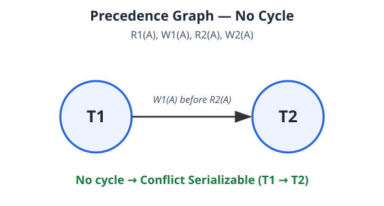
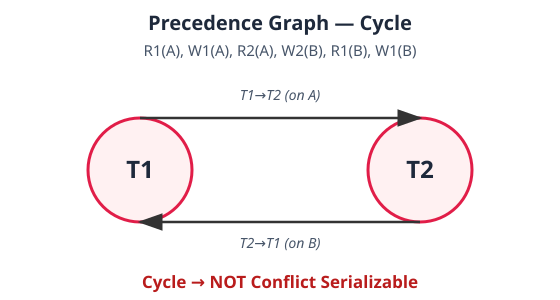

# 8.5 Conflict Serializability (Deep Dive)

A schedule is **Conflict Serializable** if we can transform it into an equivalent **serial** schedule by swapping **only non-conflicting operations**.

## Step 1: What is a Conflict?

Two operations conflict when **ALL THREE** conditions hold:

1. They belong to **different transactions**
2. They operate on the **same data item**
3. **At least one is a WRITE**

| Operation pair | Conflict? | Why |
|---|---|---|
| READ – READ | ❌ No | Nobody modifies data |
| READ – WRITE | ✅ Yes | Read value may change |
| WRITE – READ | ✅ Yes | Reader may see the write |
| WRITE – WRITE | ✅ Yes | Final value depends on order |

**Shortcut:** READ–READ never conflicts. Every other pair on the same item across different transactions conflicts.

**Non-conflicting operations** = different data items, OR both READs on the same item. These can be swapped freely.

---

## Step 2: Two Methods to Check

### Method A — Swap non-conflicting operations

Schedule S1: `R1(A), R2(B), W1(A), W2(B)`

T1 touches only A, T2 only B → no conflicts → rearrange to `R1(A), W1(A), R2(B), W2(B)` ≡ serial **T1 → T2**. ✅ Conflict Serializable.

### Method B — Precedence Graph (exam favourite)

1. One **node** per transaction.
2. For every conflicting pair, if T1's operation comes **before** T2's, draw edge **T1 → T2**.
3. **No cycle → Conflict Serializable. Cycle → NOT Conflict Serializable.**

---

## Worked Example 1 — No Cycle ✅

Schedule: `R1(A), W1(A), R2(A), W2(A)`

Conflicting pairs:
- R1(A) → W2(A): edge **T1 → T2**
- W1(A) → R2(A): edge **T1 → T2**
- W1(A) → W2(A): edge **T1 → T2**

No cycle → **Conflict Serializable**, equivalent serial order **T1 → T2**.

## Worked Example 2 — Cycle Present ❌

Schedule: `R1(A), W1(A), R2(A), W2(B), R1(B), W1(B)`

- On A: W1(A) before R2(A) → edge **T1 → T2**
- On B: W2(B) before R1(B) → edge **T2 → T1**

Cycle T1 → T2 → T1 → **NOT Conflict Serializable**. No serial order preserves all conflicting-operation orders.

## Worked Example 3 — Three Transactions, No Cycle ✅ (extra)

Schedule: `R1(A), W1(A), R2(B), W2(B), R3(A), R3(B)`

- W1(A) before R3(A) → **T1 → T3**
- W2(B) before R3(B) → **T2 → T3**
- (R1(A)→R3(A) and R2(B)→R3(B) are READ–READ: no edges)

Graph: T1 → T3 ← T2. No cycle → **Conflict Serializable**. Equivalent serial orders: **T1 → T2 → T3** or **T2 → T1 → T3**.

## Worked Example 4 — Lost Update, Cycle ❌ (extra, very exam-relevant)

T1 and T2 both read Rahul's balance ₹5,000, then both write:

Schedule: `R1(A), R2(A), W1(A), W2(A)`

- R1(A) before W2(A) → **T1 → T2**
- R2(A) before W1(A) → **T2 → T1**

Cycle → **NOT Conflict Serializable**. This is the classic **lost update problem**: one transaction's write silently overwrites the other's.

---

## Exam Checklist

1. Write down all operations in order
2. Find operations on the **same data item** in **different transactions**
3. Check at least one is a **WRITE**
4. Draw edge from **earlier** transaction → **later** transaction
5. Repeat for every conflicting pair
6. **No cycle = Conflict Serializable; Cycle = Not Conflict Serializable**

## Practice

**Q1.** Which pair never conflicts? → **READ – READ**
**Q2.** `R1(A), W2(A)` — what edge? → **T1 → T2**
**Q3.** `W2(B), R1(B)` — what edge? → **T2 → T1**
**Q4.** Graph has T1 → T2 and T2 → T1. Result? → **Not Conflict Serializable**
**Q5.** No conflicting operations between T1 and T2. Conflict serializable? → **Yes**
