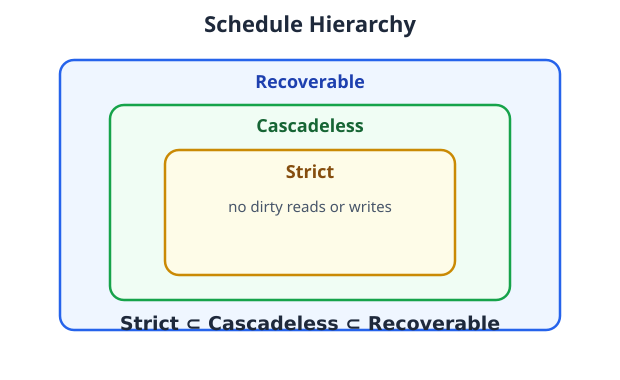

# 8.7 Recoverable, Cascadeless & Strict Schedules (Deep Dive)

These three deal with **what happens when a transaction reads data written by another transaction that hasn't committed yet** — i.e. reading *uncommitted* (dirty) data.

## Background: Cascading Rollback

```
W1(A)      ← T1 writes A (not committed yet)
R2(A)      ← T2 reads A (dirty read!)
A1         ← T1 aborts
```

T2 read data that never officially existed. Now **T2 must also roll back** — one abort *cascades* into another. This is **cascading rollback**, and these schedule types control it.

---

## 1. Recoverable Schedule

**Rule:** a transaction may commit **only after** every transaction whose data it read has committed.

✅ Recoverable:
```
W1(A), R2(A), C1, C2        ← T2 commits AFTER T1
```
T2 read T1's write but waited: T2 commits after T1 commits. Safe ordering.

❌ Unrecoverable:
```
W1(A), R2(A), C2, C1        ← T2 commits BEFORE T1
```
If T1 later aborts, T2 already committed using invalid data. Disaster.

**Extra example:** T1 transfers money (W1), T2 generates a report reading it (R2). Report must not be finalized (C2) before the transfer commits (C1).

**Remember: reader commits after its writer commits.** (Dirty reads still *possible* — only the commit order is restricted.)

## 2. Cascadeless Schedule

**Rule:** a transaction may read an item **only after** the transaction that last wrote it has **committed**. I.e. **never read uncommitted data.**

```
W1(A), C1, R2(A), C2        ← T2 reads only committed data
```

**Extra example:** T1 deducts ₹1,000 (W1) but hasn't committed. T2 wants the balance — it must WAIT until C1. No dirty reads → **no cascading rollback possible**.

**Remember: never read uncommitted data.**

## 3. Strict Schedule

**Rule:** after T1 **writes** an item, **no other transaction may READ or WRITE that item** until T1 commits or aborts.

```
W1(A), C1, R2(A), W2(A), C2
```

**Extra example — dirty write prevented:** T1 writes A = ₹4,000 (uncommitted). T2 tries `W2(A)` (overwrite) — **blocked** until T1 finishes. Strict schedules forbid both dirty reads AND dirty writes, which makes **recovery the easiest**.

**Remember: after a write, nobody touches that item until the writer finishes.**

---

## Head-to-Head Comparison (exam favourite)

| Feature | Recoverable | Cascadeless | Strict |
|---|---|---|---|
| Reads uncommitted data? | Yes, possible | **No** | **No** |
| Dirty writes allowed? | Yes, possible | Yes, possible | **No** |
| Cascading rollback possible? | Yes | **No** | **No** |
| Recovery difficulty | Harder | Easier | **Easiest** |

**One example, three versions** (T1 writes A, T2 wants A):

- Recoverable: `W1(A), R2(A), C1, C2` — T2 reads dirty but commits after T1
- Cascadeless: `W1(A), C1, R2(A), C2` — T2 reads only after T1 commits
- Strict: `W1(A), C1, R2(A), W2(A), C2` — T2 can't even *write* A until T1 commits

## The Hierarchy



**Strict ⊂ Cascadeless ⊂ Recoverable**

Every strict schedule is cascadeless (no dirty reads ⇒ reads only committed data), and every cascadeless schedule is recoverable (if you only read committed data, you trivially commit after your writers). The reverse is not true.

---

## Practice

**Q1.** Which schedule prevents cascading rollback? → **Cascadeless** (and Strict)
**Q2.** Strongest of the three? → **Strict**
**Q3.** `W1(A), R2(A), C2, C1` — recoverable? → **No** (T2 commits before T1 — unrecoverable)
**Q4.** Does cascadeless allow dirty writes? → **Yes** (it only restricts reads; strict forbids both)
**Q5.** Why is recovery easiest in strict schedules? → **No dirty reads or writes — undoing an aborted transaction never affects others**
